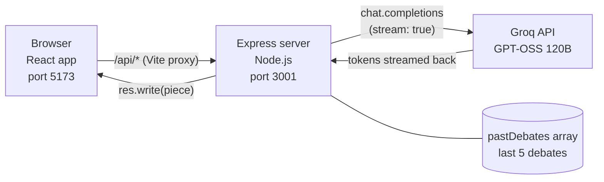

# 🧠 Brainstorm Room

**Put any idea on trial. Four AI personalities debate it live, a Moderator gives a verdict, and then you can chat with them.**

Brainstorm Room is a full-stack AI web app built with **React**, **Node.js + Express** and the **Groq API**. You type a startup or product idea, and an Engineer, a Marketer, an Investor and a Skeptic argue about it in real time. Each one reads what the others said and reacts to them. At the end, a Moderator writes a score, strengths, risks and a 7-day action plan. After the debate, you can chat one-on-one with any character, or ask all four at once.

> The characters speak in simple English, with light and clean humour, and they think about the **Indian market** (₹, UPI, WhatsApp, Indian customers and cities).

---

## 📸 Screenshots


---

## ✨ Features

- **Live AI debate.** Four characters take turns, and their replies stream onto the screen word by word.
- **Characters react to each other.** Every character receives the idea plus the full transcript so far, so the debate feels real.
- **Four distinct personalities**
  - 😏 **Engineer**: cheerful, cheeky tech nerd who gives real technical advice
  - 😈 **Marketer**: blunt and savage, but the marketing advice is real
  - 🦈 **Investor**: money-focused shark who thinks in ₹, lakh and crore
  - 💀 **Skeptic**: gloomy doomsayer who names the single biggest risk
- **Moderator verdict.** An idea score out of 10, top 3 strengths, top 3 risks, a 7-day action plan and the first question to answer.
- **Chat with the team.** Talk to one character, or choose **Everyone** and get four different answers. They reply to normal conversation too, not only to the idea.
- **Adjustable rounds.** Choose 1 to 3 debate rounds.
- **History.** The last 5 debates are saved and can be reopened with one click (stored in an in-memory array, no database).
- **India-oriented.** Rupees, UPI, WhatsApp, kirana shops, festivals and Indian competitors.
- **Safe by design.** The API key stays on the server, inputs are validated, and prompts forbid unsafe language.

---

## 🛠️ Tech Stack

| Layer | Technology | Why it is used |
|---|---|---|
| Frontend | **React** (with Vite) | Redraws the screen automatically as text streams in |
| Backend | **Node.js + Express** | Simple API server with very little code |
| AI | **Groq API** | Very fast inference, so the debate feels live |
| Model | **`openai/gpt-oss-120b`** | Follows role instructions well |
| SDK | `groq-sdk` | Official Groq client with streaming support |
| Config | `dotenv` | Keeps the API key out of the code |
| Rendering | `react-markdown` | Shows the Moderator's formatted verdict |
| Language | JavaScript (ES modules) | One language for frontend and backend |

---

## 🏗️ Architecture



**How one debate works**

1. The user enters an idea and clicks **Start the debate**.
2. For each round, and for each character, React calls `POST /api/turn` with the speaker's name, the idea and the transcript so far.
3. The server picks that character's system prompt, builds the message and calls Groq with `stream: true`.
4. Groq's answer arrives in small pieces. The server forwards each piece to the browser immediately.
5. React fills the speech bubble live. When the character finishes, their reply is added to the transcript for the next character.
6. After the last round, the Moderator reads the full transcript and writes the verdict.
7. React saves the finished debate through `POST /api/history`.

**How chat works:** `POST /api/chat` receives the character, the idea, the debate transcript, the last 10 chat messages and the new message. The server stores no conversation. React keeps it and sends it each time. In **Everyone** mode, React asks all four characters in turn and shows earlier answers to later characters so they do not repeat each other.

**Why a backend?** The Groq API key is a secret. If the browser called Groq directly, anyone could copy the key from the developer tools. The Express server keeps the key private, validates input and decides the real prompts.

---

## 📁 Project Structure

```
brainstorm-room/
├── client/                      # Frontend (React + Vite)
│   ├── src/
│   │   ├── App.jsx              # The whole UI and logic (debate, chat, history)
│   │   ├── App.css              # Dark theme, bubbles, chat styles
│   │   ├── personas.js          # Name, emoji and colour of each character
│   │   ├── index.css            # Global styles (intentionally empty)
│   │   └── main.jsx             # Entry point, mounts <App />
│   ├── index.html
│   ├── vite.config.js           # Dev proxy: /api -> http://localhost:3001
│   └── package.json
│
├── server/                      # Backend (Node.js + Express)
│   ├── index.js                 # API endpoints, Groq connection, history array
│   ├── personas.js              # Character system prompts and Moderator prompt
│   ├── .env.example             # Template for your API key
│   └── package.json
│
├── .gitignore
└── README.md
```

---

## 🔌 API Reference

Base URL (development): `http://localhost:3001`. The React dev server proxies anything starting with `/api` to it.

| Method | Endpoint | Request body | Response | Purpose |
|---|---|---|---|---|
| `GET` | `/api/history` | none | JSON array of up to 5 debates | Load saved debates |
| `POST` | `/api/history` | `{ idea, messages, summary }` | Updated JSON array | Save a finished debate |
| `POST` | `/api/turn` | `{ speaker, idea, transcript }` | Streamed plain text | One character, or the `Moderator`, speaks |
| `POST` | `/api/chat` | `{ speaker, idea, transcript, chatLog, message }` | Streamed plain text | One chat reply from a character |

**Valid `speaker` values:** `Engineer`, `Marketer`, `Investor`, `Skeptic`, and `Moderator` (only for `/api/turn`).

**Input limits**

| Field | Limit |
|---|---|
| `idea` | 1 to 1000 characters |
| `message` (chat) | 1 to 500 characters |
| `transcript` | up to 20,000 characters |
| `chatLog` | up to 10,000 characters |
| Request body | 200 KB |

**Status codes**

| Code | Meaning |
|---|---|
| `200` | Success |
| `400` | Invalid input (empty idea, unknown speaker, too long) |
| `401` | Groq rejected the API key |
| `404` | Model not found (Groq may have retired it) |
| `429` | Groq rate limit reached |
| `500` | Server problem, or missing API key |

**Example request**

```bash
curl -N -X POST http://localhost:3001/api/turn \
  -H "Content-Type: application/json" \
  -d '{"speaker":"Marketer","idea":"An app that helps street vendors accept UPI payments","transcript":""}'
```

---

## 🚀 Getting Started

### Prerequisites

- **Node.js 20 or newer** (LTS recommended). Check with `node --version`.
- **npm** (comes with Node.js).
- A free **Groq API key** from [console.groq.com](https://console.groq.com) → API Keys → Create API Key.

### 1. Clone the repository

```bash
git clone https://github.com/YOUR_USERNAME/brainstorm-room.git
cd brainstorm-room
```

### 2. Set up the backend

```bash
cd server
npm install
cp .env.example .env
```

Open `server/.env` and add your key. No quotes and no spaces:

```
GROQ_API_KEY=gsk_your_real_key_here
```

Start the server:

```bash
npm run dev
```

You should see: `Server running on http://localhost:3001`

### 3. Set up the frontend

Open a **second terminal**:

```bash
cd client
npm install
npm run dev
```

Open the link it prints, normally **http://localhost:5173**.

### 4. Try it

1. Type an idea, for example: *An app that helps street vendors accept UPI payments.*
2. Choose the number of rounds and click **Start the debate**.
3. Watch the four characters argue, then read the Moderator's verdict.
4. Use the **Chat with the team** section to ask follow-up questions, or just say hi.

---

## ⚙️ Configuration

All the settings below live in `server/index.js` unless noted.

| Setting | Default | What it does |
|---|---|---|
| `MODEL` | `openai/gpt-oss-120b` | The Groq model used for every reply |
| `temperature` | `0.9` | Creativity. Higher is funnier and more random |
| `max_tokens` | `1000` | Maximum reply length. Reasoning models use some of this for thinking, so keep it generous |
| `reasoning_effort` | `"low"` | How long the model thinks before answering. Lower is faster |
| `MAX_HISTORY` | `5` | Number of debates kept in memory |
| `PORT` | `3001` | Server port. If you change it, update the proxy in `client/vite.config.js` |

### Customising the characters

Open `server/personas.js`:

- **Change a personality:** edit the text passed to `makePersona(...)` for that character.
- **Change language and tone for everyone:** edit `STYLE_RULES`.
- **Change reply length in the debate:** edit `MEETING_RULES`. For chat, edit `CHAT_RULES`.
- **Change the final summary format:** edit `MODERATOR_PROMPT`.
- **Add a fifth character:** add a new `makePersona("Name", "...")` entry in `server/personas.js`, and add `{ name, emoji, color }` with the **exact same name** in `client/src/personas.js`.

---

## 🔒 Security Notes

- The API key lives only in `server/.env`, which is excluded by `.gitignore` and never sent to the browser.
- The server chooses the prompts. The browser sends only a character name, so users cannot rewrite the personalities.
- Every endpoint validates types and lengths, and saved debates are whitelisted to the expected fields.
- Prompts forbid swearing, sexual language and personal attacks, and tell the characters to respond kindly to serious topics.
- Users see friendly error messages. The real Groq error is printed only in the server terminal.

> ⚠️ **Never commit your `.env` file.** If a key is ever exposed, delete it in the Groq console and create a new one.

---

## 🧯 Troubleshooting

| Problem | Fix |
|---|---|
| `Something went wrong talking to Groq.` | Check the **server terminal** for the line starting with `GROQ ERROR:`. It shows the real cause |
| `model_not_found` (404) | Groq retired the model. Pick a current one at [console.groq.com/docs/models](https://console.groq.com/docs/models) and update `MODEL` |
| `No API key found` | Make sure `server/.env` exists, contains `GROQ_API_KEY=...`, and restart the server |
| `Your API key was rejected` (401) | Re-copy the key, or create a new one |
| `Rate limit reached` (429) | Wait about a minute, or use fewer rounds. One debate makes 9 to 13 requests |
| `Request failed` in the browser | The backend is not running. Start it with `npm run dev` inside `server` |
| Replies cut off or empty | Increase `max_tokens` in `server/index.js` |
| `Unknown speaker` | Character names in `client/src/personas.js` and `server/personas.js` must match exactly |
| Port already in use | Close the old terminal, or press `Ctrl + C` in it, and start again |
| Changes to `.env` or `vite.config.js` not applied | Stop that terminal and run `npm run dev` again |

---

## ⚠️ Known Limitations

- **History is in memory.** It is stored in a plain array, so it is erased when the server restarts, and it is shared by everyone using the server.
- **No user accounts.** There is no login, so all users share one history.
- **No per-user rate limiting.** Heavy use can exhaust the Groq free-tier limits.
- **The transcript is sent by the browser.** The server size-checks it but cannot verify it.
- **AI can be wrong.** The characters give opinions to help you think. They are not verified market research.
- **Development setup only.** The Vite proxy works only on your computer. A deployed version needs a few changes (see below).

---

## 🗺️ Roadmap

- [ ] Persistent storage with a database (MongoDB or PostgreSQL)
- [ ] User accounts and personal history
- [ ] Rate limiting with `express-rate-limit`
- [ ] Stop button and a progress indicator for long debates
- [ ] Voice input with Groq Whisper
- [ ] Hindi and Hinglish modes
- [ ] Custom characters chosen by the user
- [ ] Share or export a debate (link or PDF)
- [ ] Automated tests for the API
- [ ] TypeScript version

---

## ☁️ Deployment Notes

A suggested free setup is **Vercel** for the frontend and **Render** for the backend. Three changes are needed first:

1. **API address.** The Vite proxy does not exist in production. Store the server URL in an environment variable and use it in the `fetch` calls.
2. **CORS.** Install the `cors` package in the server and allow your frontend's address.
3. **Environment variables.** Add `GROQ_API_KEY` in the host's settings (never in the repo), and make the server read its port from `process.env.PORT`.

---

## 🧠 What I Learned

- Building a REST API with Express, with validation and clear status codes
- Calling an LLM API and **streaming** the response from Groq, through Express, to React
- Prompt engineering: the same model plays five roles using different system prompts
- Keeping secrets safe with environment variables and `.gitignore`
- React state, effects and conditional rendering
- Debugging a retired model by logging the real error on the server


---

*Built with React, Node.js, Express and the Groq API.*
